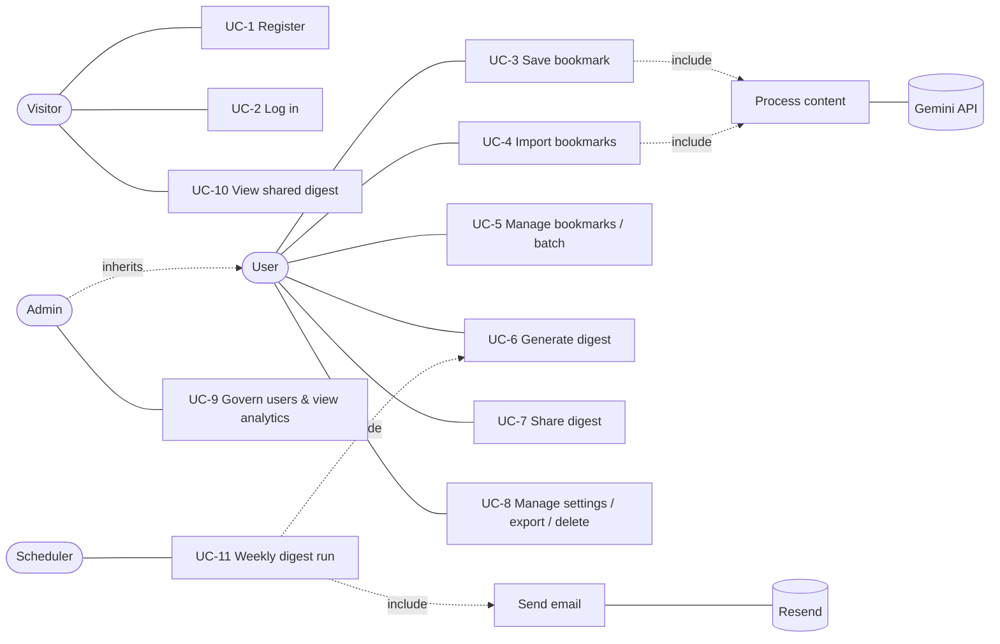

# Week 2 — Software Requirements Specification (IEEE 830)

**DigestBot – Smart Bookmark-to-Weekly Newsletter Summarizer** · Project ID PTUT-PRJ-096 · Version 1.0

---

## 1. Introduction

### 1.1 Purpose
This SRS specifies the functional and non-functional requirements of DigestBot v1.0. It is written for the
faculty supervisor, the developer, and testers, and is the baseline for design (Weeks 3–4), implementation
(Weeks 5–9) and testing (Week 10).

### 1.2 Scope
DigestBot is a web application that lets a user capture links (articles, tweets, blogs), automatically extracts
and summarises their content, classifies them by topic and priority, and compiles a weekly newsletter-style
digest that can be read in the app, emailed, or shared via a public link. An administrator portal provides
role-based user governance and usage analytics. The system is deployed on zero-cost cloud infrastructure
(Vercel + Neon serverless PostgreSQL).

### 1.3 Definitions, acronyms, abbreviations
| Term | Meaning |
|---|---|
| Bookmark | A URL saved by a user, plus extracted metadata and summary |
| Digest | A compiled weekly newsletter of a user's bookmarks for a period |
| TL;DR | Short 2–3 sentence summary |
| Extractive summary | Summary built by selecting the most important sentences of the source text (no AI service) |
| RBAC | Role-Based Access Control (`user`, `admin`) |
| SSRF | Server-Side Request Forgery |
| JWT | JSON Web Token used for the session |
| NFR | Non-Functional Requirement |

### 1.4 References
IEEE Std 830-1998; OWASP Top 10 (2021); Week 1 Problem Discovery document; Google Gemini API documentation;
Next.js 15 documentation.

### 1.5 Overview
Section 2 describes the product in general terms; Section 3 lists specific requirements (functional, use cases,
NFRs, interfaces).

## 2. Overall description

### 2.1 Product perspective
A new, self-contained, multi-tenant SaaS web application. External systems: target websites (content fetch),
X/Twitter oEmbed (tweet text), Google Gemini API (AI summaries, optional), Resend (email, optional), Vercel Cron
(scheduler).

### 2.2 Product functions (summary)
1. Account management: sign up, log in, log out, settings, data export, account deletion.
2. Bookmark capture: URL entry, bookmarklet, share page, HTML import.
3. Content processing: safe fetch, readable text extraction, AI/extractive summary, topic, tags, reading time, priority.
4. Bookmark management: list, search, filter, mark read/unread, archive, delete, batch actions, re-summarise.
5. Digest: generate weekly digest (automatic and on demand), view, email, share publicly.
6. Administration: user list, suspend/reactivate, promote/demote, analytics dashboard, event log.

### 2.3 User classes and characteristics
| Class | Description | Privileges |
|---|---|---|
| Visitor | Not logged in | Landing page, sign up, log in, view shared digests |
| User | Registered professional (personas Ayesha, Bilal) | Own bookmarks, digests, settings only |
| Admin | Platform operator | Everything a User can do + admin portal |
| Scheduler | Vercel Cron (system actor) | Calls the protected cron endpoint |

### 2.4 Operating environment
Modern evergreen browsers (Chrome, Edge, Firefox, Safari — desktop and mobile). Server: Node.js 20+ serverless
functions on Vercel; PostgreSQL 16 (Neon). Local development uses embedded PGlite (PostgreSQL in WebAssembly).

### 2.5 Design and implementation constraints
- Zero-cost hosting tier (Vercel Hobby: one cron per day, 10 s default function duration).
- Must work without an AI key (graceful degradation to extractive summarisation).
- TypeScript, Next.js App Router, Drizzle ORM.

### 2.6 Assumptions and dependencies
- Target pages are publicly reachable HTML; paywalled or JS-only pages may yield only title/description.
- Gemini and Resend free tiers remain available; if not, the fallbacks keep the system usable.

## 3. Specific requirements

### 3.1 Functional requirements

| ID | Requirement | Priority |
|---|---|---|
| FR-1 | The system shall allow a visitor to register with name, email and password (min 8 chars, letters and digits). | High |
| FR-2 | The system shall store passwords only as bcrypt hashes (cost ≥ 12). | High |
| FR-3 | The system shall authenticate users with email + password and issue a signed, HTTP-only session cookie (JWT, 7-day expiry). | High |
| FR-4 | The system shall isolate all bookmark and digest data per user (multi-tenancy); a user can never read or change another user's data. | High |
| FR-5 | The user shall be able to save a URL; duplicates (same normalised URL) shall be detected and not created twice. | High |
| FR-6 | The system shall fetch the page, reject private/internal network addresses, and extract title, site name, readable text and excerpt. | High |
| FR-7 | The system shall produce a summary (2–3 sentences), up to 3 key points, topic, up to 5 tags, reading time and priority for each bookmark, using Gemini when configured, otherwise the extractive engine. | High |
| FR-8 | The user shall be able to search bookmarks by text and filter by status and topic, with pagination. | High |
| FR-9 | The user shall be able to mark read/unread, archive, delete and re-summarise a bookmark, individually or in batch (up to 100). | Medium |
| FR-10 | The user shall be able to import bookmarks from a browser bookmarks HTML export (up to 500 links per import). | Medium |
| FR-11 | The system shall offer a bookmarklet and a share URL (`/save?url=`) for one-click capture. | Medium |
| FR-12 | The system shall generate a digest for a 7-day period, grouping bookmarks by topic, with an intro, statistics and up to 3 "worth a full read" picks. | High |
| FR-13 | The scheduler shall generate digests automatically on each user's chosen weekday and email them when email delivery is enabled. | High |
| FR-14 | The user shall be able to generate a digest on demand, view past digests, and delete a digest. | Medium |
| FR-15 | The user shall be able to make a digest public via an unguessable share link and revoke it. | Medium |
| FR-16 | The user shall be able to set digest weekday, email preference and display name, change password, export all data as JSON and delete the account. | Medium |
| FR-17 | Admins shall see platform metrics (users, bookmarks, digests, AI vs. extractive summaries) and 30-day activity charts. | Medium |
| FR-18 | Admins shall be able to suspend/reactivate users and change roles; a suspended user cannot log in or use the API. | Medium |
| FR-19 | Security-relevant events (signup, login, failed login, role change, suspension) shall be recorded in an event log visible to admins. | Medium |
| FR-20 | The system shall expose a health endpoint reporting application and database status. | Low |

### 3.2 Use cases

**System use case diagram**

**UC-3 Save bookmark**
| Field | Value |
|---|---|
| Actor | User |
| Preconditions | User is logged in and not suspended |
| Trigger | User pastes a URL and presses *Save*, uses the bookmarklet, or opens `/save?url=` |
| Main flow | 1. System validates the URL (http/https, ≤ 2048 chars). 2. System normalises it (lower-case host, strip tracking params `utm_*`, `fbclid`, fragment). 3. System checks for duplicate. 4. System stores the bookmark with status *unread* and summary *pending* and responds immediately. 5. In the background the system fetches and processes the content (UC "Process content") and updates the bookmark. |
| Alternative flows | 3a. Duplicate → system returns the existing bookmark with `duplicate: true`. 5a. Fetch fails or host is private → bookmark keeps the URL as title, summary source *failed*, user may retry. 5b. Gemini fails or is not configured → extractive summary is used. |
| Postconditions | Bookmark exists, owned by user, eventually summarised |

**UC-6 Generate digest**
| Field | Value |
|---|---|
| Actor | User (on demand) or Scheduler |
| Preconditions | User has ≥ 1 non-archived bookmark saved in the period |
| Main flow | 1. System selects bookmarks created in the last 7 days (excluding archived). 2. Orders by priority then recency, caps at 30 items. 3. Groups them into topic sections (largest first). 4. Picks up to 3 high-priority unread items as "worth a full read". 5. Computes statistics (items, total reading minutes, minutes saved). 6. Writes an intro (AI or template). 7. Stores the digest. |
| Alternative flows | 1a. No bookmarks → 422 "Nothing to digest yet". Scheduler: 1b. Digest already exists for this week → skip. |
| Postconditions | Digest stored; (scheduler) email sent if enabled |

**UC-7 Share digest**: User opens a digest → toggles *Share* → system generates a 24-byte random token →
public URL `/d/{token}` shows a read-only view; toggling off deletes the token (link stops working).

**UC-9 Govern users**: Admin opens `/admin` → sees metrics and charts → opens Users → suspends a user → system
sets status *suspended*, logs `admin.user_suspended`; the user's next request is rejected with 403.

**UC-11 Weekly digest run**: Vercel Cron calls `GET /api/cron/weekly` daily with `Authorization: Bearer
CRON_SECRET` → system processes up to 25 pending bookmarks, then for every active user whose digest weekday is
today and who has no digest in the last 6 days, runs UC-6 and emails it if enabled.

### 3.3 Non-functional requirements (quantified)

| ID | Category | Requirement | Verification |
|---|---|---|---|
| NFR-1 | Latency | p95 response time of authenticated JSON API reads (list bookmarks, list digests) ≤ 500 ms at the Vercel edge region nearest the database | Measured with browser devtools / `curl -w` over 20 requests |
| NFR-2 | Latency | Saving a bookmark returns to the user in ≤ 800 ms (p95); content processing completes in the background within 15 s | Timing logged in the event log |
| NFR-3 | Latency | Public pages (landing, shared digest) First Contentful Paint ≤ 1.5 s on 4G (Lighthouse) | Lighthouse report |
| NFR-4 | Availability | ≥ 99.5 % monthly uptime of the application (Vercel + Neon SLAs); `/api/health` returns 200 when DB reachable | Health check monitoring |
| NFR-5 | Security | Passwords hashed with bcrypt cost 12; sessions in `HttpOnly`, `Secure`, `SameSite=Lax` cookies; JWT signed HS256 with ≥ 32-byte secret | Code review, tests |
| NFR-6 | Security | All mutating API requests verify the `Origin` header (CSRF defence); all inputs validated with Zod schemas; all SQL parameterised via ORM | Tests, static scan |
| NFR-7 | Security | Server-side fetches block private, loopback, link-local and metadata IP ranges (SSRF), limit response size to 2 MB, time out after 8 s, max 5 redirects | Unit tests |
| NFR-8 | Security | Login limited to 10 attempts / 15 min per IP+email; bookmark creation 200 / hour per user | Tests |
| NFR-9 | Security | Security headers: CSP, `X-Frame-Options: DENY`, `X-Content-Type-Options: nosniff`, `Referrer-Policy`, HSTS | securityheaders.com scan |
| NFR-10 | Privacy | User can export all personal data (JSON) and delete the account with cascade deletion | Tests |
| NFR-11 | Maintainability | ≥ 70 % automated test coverage on core domain logic (`src/lib`); CI runs lint, type-check, tests and build on every push | CI report |
| NFR-12 | Usability | Fully responsive from 360 px width; all actions give toast feedback; WCAG AA colour contrast | Manual test |
| NFR-13 | Scalability | Stateless serverless functions; DB indexes on `(user_id, created_at)`, `(user_id, status)`; supports 1 000 users × 1 000 bookmarks on free tier | ERD/index review |
| NFR-14 | Cost | Runs entirely on free tiers (Vercel Hobby, Neon Free, Gemini free tier, Resend free tier) | Deployment review |

### 3.4 External interface requirements
- **User interface:** responsive web UI (landing, auth, dashboard, digests, settings, admin). Wireframes in Week 4.
- **Software interfaces:** PostgreSQL (Neon) over HTTPS; Gemini `generateContent` REST API (JSON mode);
  X/Twitter `publish.twitter.com/oembed`; Resend `POST /emails`.
- **Communications:** HTTPS only (TLS by Vercel); JSON REST API (contracts in Week 4 document).

### 3.5 Traceability (feature → requirements)
| MVP feature (Week 1) | Requirements |
|---|---|
| 1. One-click capture | FR-5, FR-10, FR-11 |
| 2. Extraction & AI summary | FR-6, FR-7, NFR-2, NFR-7 |
| 3. Smart triage | FR-7, FR-8, FR-9 |
| 4. Weekly digest | FR-12, FR-13, FR-14 |
| 5. Shareable digest | FR-15 |
| Accounts & security | FR-1–FR-4, FR-16, NFR-5–NFR-10 |
| Admin | FR-17–FR-19 |
