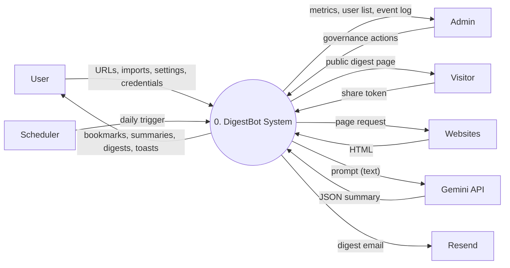
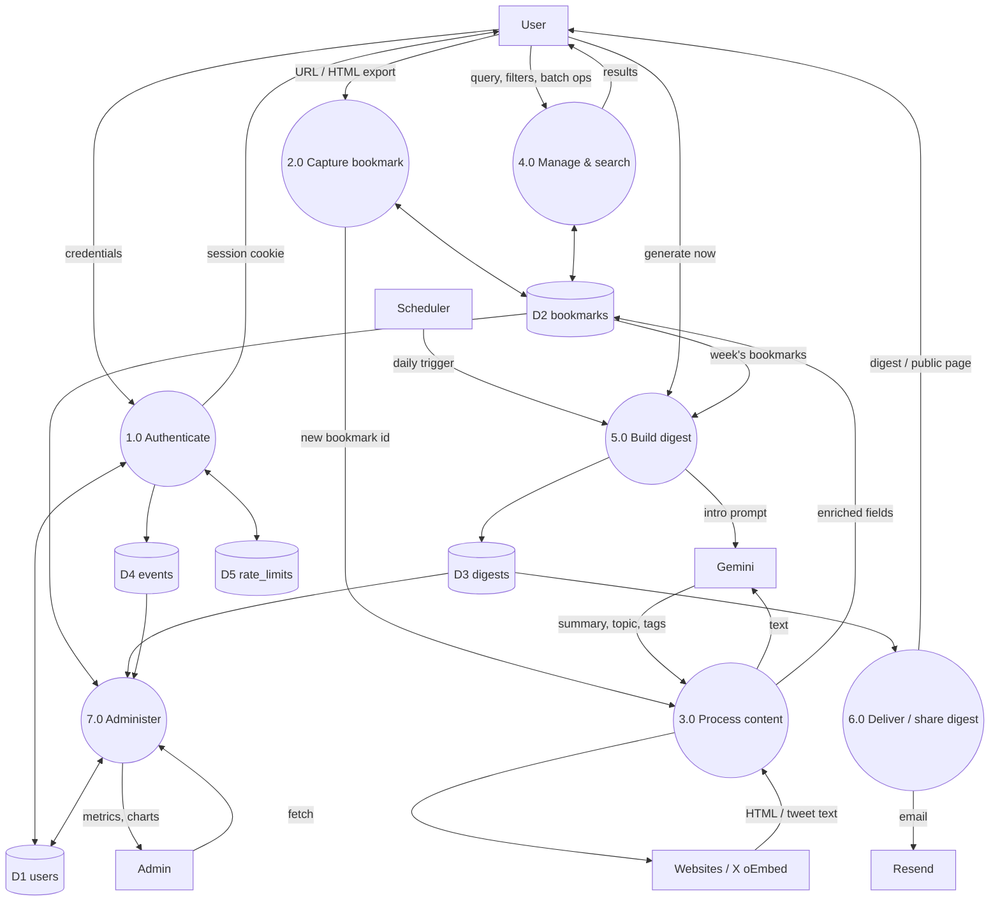
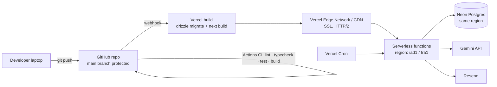

# Week 3 — High-Level Architecture & Cloud Topology

**DigestBot** · Project ID PTUT-PRJ-096

---

## 1. 3-tier architecture

```mermaid
flowchart TB
  subgraph T1[Tier 1 — Client]
    B[Browser: React 19 UI<br/>Landing · Dashboard · Digests · Settings · Admin]
    BM[Bookmarklet / share URL]
  end
  subgraph T2[Tier 2 — Application / API server  (Vercel serverless, Next.js 15)]
    MW[Middleware<br/>route guard, security headers]
    API[REST route handlers /api/*<br/>Zod validation · Origin check · rate limits]
    SVC[Service layer<br/>auth · bookmarks · digests · admin]
    DOM[Domain logic src/lib<br/>URL safety · extractor · summarizer · topics · digest builder]
    CRON[Cron handler /api/cron/weekly]
  end
  subgraph T3[Tier 3 — Data]
    PG[(Neon serverless PostgreSQL 16)]
  end
  EXT1[(Target websites)]
  EXT2[(Google Gemini API)]
  EXT3[(Resend email API)]
  EXT4[(X oEmbed)]
  VC[Vercel Cron — daily 07:00 UTC]

  B -- HTTPS JSON + session cookie --> MW --> API --> SVC --> DOM
  BM -- HTTPS --> MW
  SVC -- Drizzle ORM, parameterised SQL over HTTPS --> PG
  DOM -- safe fetch --> EXT1
  DOM -- tweets --> EXT4
  DOM -- summaries / intros --> EXT2
  SVC -- digest email --> EXT3
  VC -- Bearer CRON_SECRET --> CRON --> SVC
```

**Layer responsibilities**

| Layer | Folder | Responsibility | Depends on |
|---|---|---|---|
| Presentation | `src/app/(pages)`, `src/components` | Pages, forms, toasts, charts | REST API |
| API | `src/app/api/**/route.ts` | HTTP concerns: parse, validate, authorise, map errors to status codes | Services |
| Service | `src/server/*` | Use-case orchestration, DB access, multi-tenant scoping (`where user_id = $me`) | DB, domain |
| Domain | `src/lib/*` | Pure business logic, no DB — fully unit-tested | — |
| Data | `src/db/*` | Schema, migrations, connection (Neon in prod, PGlite locally/tests) | PostgreSQL |

## 2. Data flow diagrams

### DFD Level 0 (context diagram)



### DFD Level 1



## 3. System boundaries

**Inside the system (we build and own):** web UI, REST API, auth, content extraction, extractive summariser,
topic classifier, digest builder, scheduler handler, admin portal, database schema.

**Outside the system (integrated, not owned):**
| External system | Used for | Failure behaviour |
|---|---|---|
| Target websites | Article HTML | Bookmark stays with URL/title, marked *failed*, retry available |
| X oEmbed | Tweet text (X pages need JavaScript) | Falls back to normal fetch |
| Google Gemini | Abstractive summary, topic, digest intro | Extractive summariser + rule-based topic + template intro |
| Resend | Email delivery | Digest still available in-app; failure recorded in event log |
| Vercel Cron | Daily trigger | User can always generate on demand |

**Trust boundaries:** (1) browser ↔ API — everything from the client is untrusted, validated with Zod;
(2) API ↔ internet — fetched HTML is untrusted: never rendered as HTML, only text is extracted, private IPs
blocked; (3) API ↔ Gemini — model output is parsed against a JSON schema and clamped to the allowed topic list;
(4) cron ↔ API — shared secret.

## 4. Cloud infrastructure stack and justification

| Concern | Choice | Why this over alternatives |
|---|---|---|
| Hosting / compute | **Vercel (Hobby, free)** | Native Next.js host; serverless functions + CDN + automatic SSL + preview deployments from GitHub; built-in Cron. Render free tier sleeps after 15 min (30 s cold starts). |
| Database | **Neon serverless PostgreSQL (free: 0.5 GB, autoscaling to zero)** | Relational data (users → bookmarks → digests) with joins, constraints, cascade deletes and JSONB; HTTP driver suits serverless (no connection pool exhaustion); one-click Vercel integration injects `DATABASE_URL`; branching for previews. MongoDB Atlas would lose relational integrity; Supabase is also good but bundles auth/storage we don't need and pauses idle free projects after 7 days. |
| Local DB / tests | **PGlite** (Postgres compiled to WASM, in-process) | Same SQL dialect as production with zero install; tests run a real Postgres in memory. |
| ORM / migrations | **Drizzle ORM + drizzle-kit** | Type-safe SQL, tiny runtime (fast cold starts), supports both Neon HTTP and PGlite drivers, SQL migrations committed to Git. |
| Framework | **Next.js 15 App Router, React 19, TypeScript** | One codebase for UI + API; server components; `after()` for post-response background processing. |
| Styling | Tailwind CSS v4 | Rapid responsive UI, small CSS output. |
| Auth | Custom: bcryptjs + `jose` JWT in HTTP-only cookie | Meets the brief explicitly (bcrypt, JWT); no third-party lock-in; DB check per request enforces suspension. |
| AI | **Google Gemini 2.5 Flash** (free tier) | Low latency, JSON-schema output mode, generous free quota. Optional — extractive fallback. |
| Email | **Resend** (free: 3 000 emails/month) | Simple REST API, good deliverability. Optional. |
| Scheduler | Vercel Cron | Free, configured in `vercel.json`. Hobby plan allows one run per day, so the job runs daily and picks users whose weekday matches. |
| CI | GitHub Actions | Lint, type-check, tests with coverage, production build on every push / PR. |

## 5. Deployment topology



Environment variables (set in Vercel, never committed): `DATABASE_URL`, `AUTH_SECRET`, `CRON_SECRET`,
`GEMINI_API_KEY` (optional), `RESEND_API_KEY` + `EMAIL_FROM` (optional), `ADMIN_EMAILS`, `APP_URL`.
