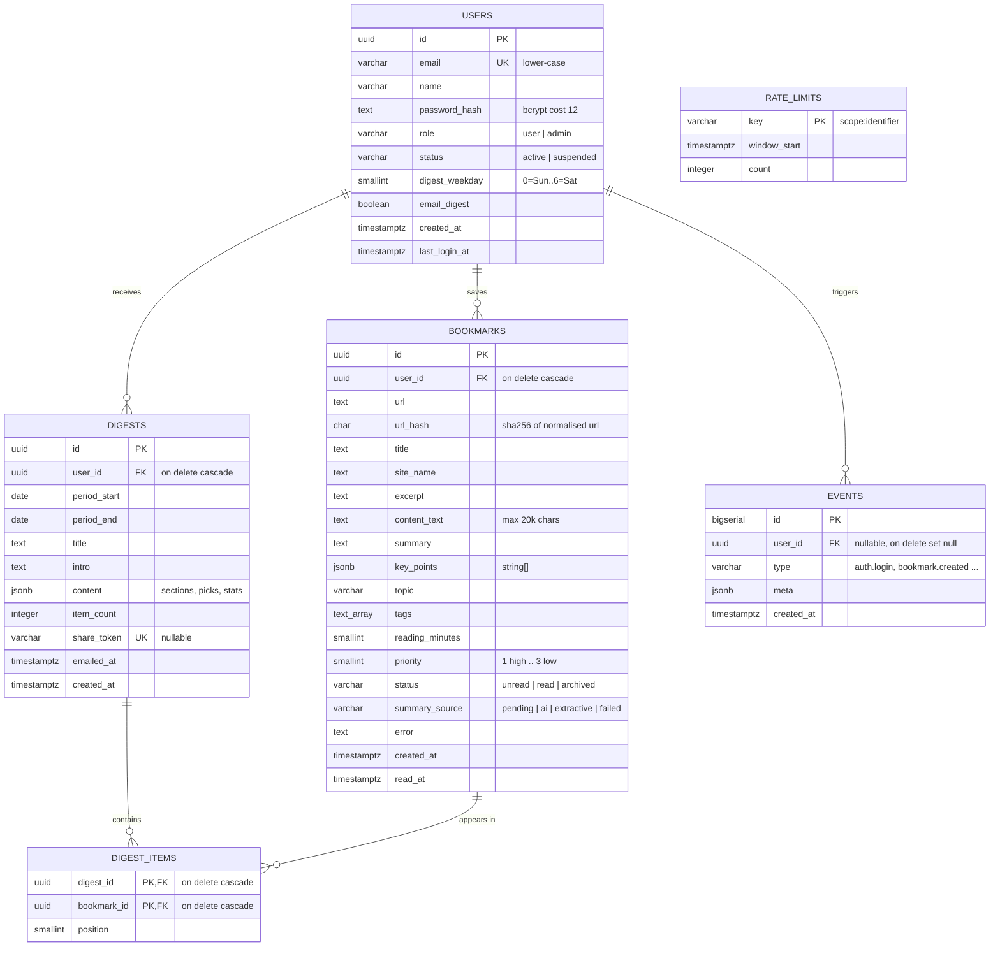

# Week 4 — Database Model, API Contracts & UI Wireframes

**DigestBot** · Project ID PTUT-PRJ-096

---

## 1. Entity-Relationship Diagram



### Index definitions

| Table | Index | Type | Serves |
|---|---|---|---|
| users | `users_email_uq (email)` | UNIQUE B-tree | login lookup, duplicate signup |
| bookmarks | `bookmarks_user_url_uq (user_id, url_hash)` | UNIQUE B-tree | duplicate detection (FR-5) |
| bookmarks | `bookmarks_user_created_idx (user_id, created_at DESC)` | B-tree | dashboard list, weekly digest range query |
| bookmarks | `bookmarks_user_status_idx (user_id, status)` | B-tree | status filter, unread counts |
| bookmarks | `bookmarks_pending_idx (summary_source) WHERE summary_source = 'pending'` | Partial B-tree | cron backlog processing |
| digests | `digests_user_created_idx (user_id, created_at DESC)` | B-tree | digest list, "already sent this week" check |
| digests | `digests_share_token_uq (share_token)` | UNIQUE B-tree | public share lookup |
| events | `events_created_idx (created_at)` | B-tree | admin 30-day charts |
| events | `events_type_created_idx (type, created_at)` | B-tree | per-event-type analytics |

Normalisation: 3NF. `digest_items` resolves the M:N between digests and bookmarks; `content` JSONB on digests is
a deliberate denormalised snapshot so that a digest still reads the same after bookmarks are edited or deleted.

## 2. REST API contracts

Conventions: JSON bodies; session via `db_session` HTTP-only cookie; errors are
`{ "error": { "code": string, "message": string, "fields"?: Record<string,string> } }`.
All mutating requests must send a same-origin `Origin` header. Status codes: 200 OK, 201 Created,
400 validation, 401 unauthenticated, 403 forbidden/suspended/bad origin, 404 not found, 409 conflict,
422 unprocessable, 429 rate-limited, 500 server error.

### 2.1 Auth
| Method & path | Body | Success | Errors |
|---|---|---|---|
| `POST /api/auth/signup` | `{ name, email, password }` | 201 `{ user }` + cookie | 400, 409 email exists, 429 |
| `POST /api/auth/login` | `{ email, password }` | 200 `{ user }` + cookie | 400, 401 invalid, 403 suspended, 429 |
| `POST /api/auth/logout` | – | 200 `{ ok: true }` (cookie cleared) | – |
| `GET /api/auth/me` | – | 200 `{ user }` | 401 |

`user = { id, name, email, role, digestWeekday, emailDigest, createdAt }`

### 2.2 Bookmarks
| Method & path | Request | Success |
|---|---|---|
| `GET /api/bookmarks?q=&status=unread\|read\|archived\|all&topic=&page=1&pageSize=20` | – | 200 `{ items: Bookmark[], total, page, pageSize, topics: {topic,count}[] }` |
| `POST /api/bookmarks` | `{ url, title? }` | 201 `{ bookmark, duplicate: false }` · 200 `{ bookmark, duplicate: true }` |
| `GET /api/bookmarks/{id}` | – | 200 `{ bookmark }` · 404 |
| `PATCH /api/bookmarks/{id}` | `{ status?, priority?, topic? }` | 200 `{ bookmark }` |
| `DELETE /api/bookmarks/{id}` | – | 200 `{ ok: true }` |
| `POST /api/bookmarks/{id}/resummarize` | – | 200 `{ bookmark }` |
| `POST /api/bookmarks/batch` | `{ ids: uuid[1..100], action: "read"\|"unread"\|"archive"\|"delete" }` | 200 `{ updated: n }` |
| `POST /api/bookmarks/import` | `multipart/form-data file` (Netscape bookmarks HTML ≤ 2 MB) | 200 `{ imported, duplicates, skipped }` |

`Bookmark = { id, url, title, siteName, excerpt, summary, keyPoints[], topic, tags[], readingMinutes,
priority, status, summarySource, error, createdAt, readAt }`

### 2.3 Digests
| Method & path | Request | Success |
|---|---|---|
| `GET /api/digests` | – | 200 `{ items: DigestSummary[] }` |
| `POST /api/digests` | `{ days?: 1..31 }` (default 7) | 201 `{ digest }` · 422 nothing to digest |
| `GET /api/digests/{id}` | – | 200 `{ digest }` |
| `PATCH /api/digests/{id}` | `{ shared: boolean }` | 200 `{ digest }` (with `shareUrl`) |
| `DELETE /api/digests/{id}` | – | 200 `{ ok: true }` |
| `POST /api/digests/{id}/email` | – | 200 `{ ok: true }` · 503 email not configured |
| `GET /d/{token}` (page) | – | Public HTML digest · 404 |

`Digest = { id, title, intro, periodStart, periodEnd, itemCount, shared, shareUrl, emailedAt, createdAt,
content: { stats: { items, readingMinutes, minutesSaved, topics }, picks: Item[], sections: [{ topic, items: Item[] }] } }`

### 2.4 Settings & account
| Method & path | Request | Success |
|---|---|---|
| `GET /api/settings` | – | 200 `{ user, features: { ai, email } }` |
| `PATCH /api/settings` | `{ name?, digestWeekday?, emailDigest? }` | 200 `{ user }` |
| `POST /api/settings/password` | `{ currentPassword, newPassword }` | 200 `{ ok }` · 401 |
| `GET /api/account/export` | – | 200 JSON file download |
| `DELETE /api/account` | `{ password }` | 200 `{ ok }` (cascade delete, cookie cleared) |

### 2.5 Admin (role = admin, else 403)
| Method & path | Request | Success |
|---|---|---|
| `GET /api/admin/metrics` | – | 200 `{ totals, summarySources, topics, daily: [{date, signups, bookmarks, digests}] (30 days) }` |
| `GET /api/admin/users?q=&page=` | – | 200 `{ items: AdminUser[], total }` |
| `PATCH /api/admin/users/{id}` | `{ role?, status? }` | 200 `{ user }` · 400 cannot change self |
| `GET /api/admin/events?type=&page=` | – | 200 `{ items: Event[], total }` |

### 2.6 System
| Method & path | Auth | Success |
|---|---|---|
| `GET /api/health` | none | 200 `{ status: "ok", db: "ok", version, time }` · 503 if DB down |
| `GET /api/cron/weekly` | `Authorization: Bearer CRON_SECRET` | 200 `{ processed, digests, emailed }` · 401 |

## 3. UI wireframes (6 primary screens)

### W1 — Landing page
```
┌──────────────────────────────────────────────────────────────┐
│ ◆ DigestBot                              [Log in] [Get started]│
├──────────────────────────────────────────────────────────────┤
│        Your 50 saved links, read for you.                      │
│   Save anything. Get one 5-minute digest every week.           │
│            [ Start free ]   [ See how it works ]               │
│  ┌────────────┐ ┌────────────┐ ┌────────────┐                  │
│  │1 Save in 1 │ │2 AI reads & │ │3 Sunday    │                  │
│  │  click     │ │  summarises │ │  digest    │                  │
│  └────────────┘ └────────────┘ └────────────┘                  │
│  [ sample digest preview card ]                                │
└──────────────────────────────────────────────────────────────┘
```

### W2 — Sign up / Log in
```
┌───────────────────────────┐
│ ◆ DigestBot               │
│ Create your account       │
│ Name     [_____________]  │
│ Email    [_____________]  │
│ Password [_____________]  │
│ [      Create account   ] │
│ Have an account? Log in   │
└───────────────────────────┘
```

### W3 — Dashboard / reading queue
```
┌──────────────────────────────────────────────────────────────┐
│ ◆ DigestBot   Library  Digests  Settings  (Admin)   Ayesha ▾ │
├──────────────────────────────────────────────────────────────┤
│ [ Paste a link to save…                         ] [ Save ]    │
│ ┌ 42 unread ┐ ┌ 3 h 10 m to read ┐ ┌ 7 this week ┐ ┌ 4 digests┐│
│ Search [________]  Status [Unread▾]  Topic chips: AI · Web · …│
│ ☐ select all     [Mark read] [Archive] [Delete]               │
│ ┌──────────────────────────────────────────────────────────┐ │
│ │☐ ● HIGH  Postgres 17 is out — what's new      7 min · AI ▸│ │
│ │   blog.example.com · TL;DR two lines…                     │ │
│ │   • key point • key point          [✓][⟳][🗄][🗑]          │ │
│ └──────────────────────────────────────────────────────────┘ │
│ … more cards …                          ‹ 1 2 3 ›             │
└──────────────────────────────────────────────────────────────┘
```

### W4 — Digest list & digest view
```
┌──────────────────────────────────────────────────────────────┐
│ Digests                          [ Generate this week's now ] │
│ ▸ Week of 12 Oct — 14 links · 1 h 32 m saved   [shared]       │
│ ▸ Week of 5 Oct  — 9 links                                     │
├──────────────────────────────────────────────────────────────┤
│  YOUR WEEKLY DIGEST · 12–18 Oct                               │
│  "This week you saved 14 links, mostly about AI…" (intro)     │
│  [14 links] [1 h 40 m of reading] [5 min digest]              │
│  ★ Worth a full read: 1… 2… 3…                                 │
│  ── AI & Machine Learning (6) ──                               │
│   Title → TL;DR · 3 key points · Read original ↗              │
│  ── Web Development (4) ──                                    │
│  [Share link ⧉ on/off] [Email me] [Delete]                    │
└──────────────────────────────────────────────────────────────┘
```

### W5 — Settings
```
┌──────────────────────────────────────────────────────────────┐
│ Profile: Name [____]                                [Save]    │
│ Digest: Day [Sunday▾]  ☑ Email me my digest                    │
│ Capture: Bookmarklet [⇱ Save to DigestBot] (drag to toolbar)  │
│ Import: [Choose bookmarks.html] [Import]                       │
│ Security: current [__] new [__] [Change password]              │
│ Data: [Export my data]   Danger zone: [Delete account]         │
└──────────────────────────────────────────────────────────────┘
```

### W6 — Admin portal
```
┌──────────────────────────────────────────────────────────────┐
│ Admin ▸ Overview | Users | Events                             │
│ [Users 128] [Active 7d 54] [Bookmarks 6 210] [Digests 412]    │
│ ┌ Daily activity (30 days) — bars: bookmarks, line: signups ┐ │
│ └──────────────────────────────────────────────────────────┘ │
│ ┌ Summary source: AI 71% / Extractive 25% / Failed 4% ┐ ┌ Topics ┐│
│ Users: search [____]                                           │
│  Name  Email  Role[user▾]  Status  Bookmarks  Joined [Suspend]│
└──────────────────────────────────────────────────────────────┘
```
