# DigestBot — Smart Bookmark-to-Weekly Newsletter Summarizer

## Final Year Project Report

| | |
|---|---|
| **Project ID** | PTUT-PRJ-096 |
| **Track** | 10. Productivity, Remote Work & Asynchronous Collaboration |
| **Student** | _[Your name, roll number]_ |
| **Supervisor** | _[Supervisor name]_ |
| **Department / University** | _[Department, University]_ |
| **Submission date** | _[Date]_ |
| **Live system** | https://digestbot-phi.vercel.app |
| **Source code** | https://github.com/RanaBadarMunir/digestbot |

---

## Abstract

Knowledge workers save far more articles, social-media threads and technical blogs "to read later" than they
ever read, and the resulting backlog of 50 or more unread links turns into guilt rather than knowledge. This
project designed, built, tested and deployed **DigestBot**, a multi-tenant web application that captures links in
one click, safely fetches and extracts each page's readable text, summarises it into a short TL;DR with three key
points (using Google Gemini, or an offline extractive algorithm when no AI service is available), classifies it by
topic and priority, and compiles everything saved during a week into a single newsletter-style digest that can be
read in about five minutes, emailed, or shared with a team through a public link. An administrator portal
provides role-based governance and usage analytics. The system is implemented in TypeScript with Next.js 15,
PostgreSQL (Neon, serverless) and Drizzle ORM, deployed at zero cost on Vercel with a daily scheduler, and
verified by 117 automated tests with 97.5 % line coverage of the domain and service layers, an OWASP Top 10
review and a clean production dependency audit. Measured from Pakistan, the deployed API answers in a median of
about 350–380 ms, including roughly 250 ms of intercontinental network round-trip.

**Keywords:** read-later, summarisation, extractive summarisation, large language models, newsletter, Next.js,
serverless PostgreSQL, SSRF, asynchronous collaboration.

---

## Table of contents

1. Introduction
2. Background and related work
3. Requirements
4. System design
5. Implementation
6. Testing and quality assurance
7. Deployment and operations
8. Results and evaluation
9. Project management
10. Limitations and future work
11. Conclusion
12. References
- Appendix A — Screenshots
- Appendix B — User manual
- Appendix C — Installation and deployment guide
- Appendix D — API summary

---

## 1. Introduction

### 1.1 Problem statement
Knowledge workers in remote and asynchronous teams save dozens of articles, tweets and technical blogs every
week "to read later", but the saved links pile up across browsers, chat apps and read-later tools with no
triage, no reminder and no rhythm. The backlog grows to 50+ unread links and the knowledge they meant to absorb
is lost. Existing bookmark tools store links but do not read, rank or summarise them, so the backlog becomes guilt
rather than value. (Full discovery work: `docs/01-problem-discovery-and-personas.md`.)

### 1.2 Aim
To build a system that turns an unread pile of saved links into one short, prioritised weekly digest, so that every
saved link produces some value without hours of reading.

### 1.3 Objectives
| # | Objective | Status |
|---|---|---|
| O1 | Capture links with one click (paste, bookmarklet, mobile share URL, bulk import) | Achieved |
| O2 | Safely fetch pages and extract readable text, including X/Twitter posts | Achieved |
| O3 | Summarise each link into a TL;DR + 3 key points, with and without an AI service | Achieved |
| O4 | Classify by topic, tags, reading time and priority; search, filter, batch-manage | Achieved |
| O5 | Compile and deliver a weekly digest automatically on the user's chosen day | Achieved (email optional, needs a Resend key) |
| O6 | Share a digest with a team through a revocable public link | Achieved |
| O7 | Provide an admin portal with RBAC, analytics and an audit log | Achieved |
| O8 | Meet security, test-coverage (≥ 70 %) and zero-cost deployment targets | Achieved |

### 1.4 Scope
In scope: individual user accounts, the five MVP features, administration, deployment. Out of scope (future
work): team workspaces with shared bookmark pools, a browser extension, Slack/Telegram ingestion, native mobile
apps, paywalled content.

### 1.5 Report structure
Chapter 2 reviews existing tools and techniques; 3 summarises requirements; 4 the design; 5 the implementation;
6 testing; 7 deployment; 8 evaluates the result against the requirements; 9 covers project management; 10
limitations and future work; 11 concludes.

---

## 2. Background and related work

### 2.1 Existing products
| Product category | What it does well | Gap DigestBot addresses |
|---|---|---|
| Browser bookmarks | Built-in, zero friction to save | No content, no triage, no reminder |
| Read-later apps (e.g. Pocket, Instapaper) | Clean reading view, offline reading | The user still has to read everything; no weekly synthesis |
| Highlight/annotation readers (e.g. Readwise Reader, Matter) | Powerful for active readers, some AI features | Built for people who already read; paid tiers; individual focus |
| Newsletter curation tools | Good for publishing to an audience | Curator does all the reading and writing by hand |
| "Message to self" in chat apps | Always at hand on mobile | Links get buried; no structure at all |

None of these turns a user's *own* backlog into a short, automatically compiled, prioritised digest delivered on a
fixed weekly rhythm — the gap identified in the Week 1 interviews (themes F1 backlog overwhelm, F2 no triage,
F4 no rhythm).

### 2.2 Text summarisation techniques
- **Extractive summarisation** selects the most informative sentences from the source. Classic approaches score
  sentences by term frequency (Luhn, 1958), position, or graph centrality (TextRank, LexRank). They are fast,
  deterministic, need no external service, and never invent facts, but read less fluently.
- **Abstractive summarisation** generates new sentences. Modern large language models (LLMs) such as Google
  Gemini produce fluent summaries and can also classify and tag in one call, at the cost of an external
  dependency, latency, quotas and the possibility of errors or prompt injection from the source text.

DigestBot uses **both**: an LLM when configured, with a TF-based extractive engine as an always-available
fallback (graceful degradation), and treats model output as untrusted (schema-validated, topic allow-list).

### 2.3 Web content extraction and SSRF
Fetching arbitrary user-supplied URLs from a server is a classic **Server-Side Request Forgery** risk (OWASP Top
10 2021, A10): an attacker can point the server at internal addresses such as cloud metadata endpoints. The
standard mitigations — scheme allow-lists, resolving DNS and rejecting private ranges, re-validating every
redirect hop, timeouts and size caps — are implemented and unit-tested (§5.4). Readable-text extraction uses
Mozilla's Readability algorithm (the engine behind Firefox Reader View).

### 2.4 Serverless architecture
Serverless platforms (Vercel functions) scale to zero and are free at small scale, but have short-lived
instances, so connection-pooled databases and in-memory state are unsuitable. This motivated an HTTP-based
PostgreSQL driver (Neon), database-backed rate limiting, and post-response background work.

---

## 3. Requirements

The full IEEE 830 SRS is in `docs/02-srs.md` (20 functional requirements, 11 use cases, 14 quantified NFRs).
Summary:

- **Users:** Visitor, User (personas Ayesha — busy engineer; Bilal — product manager), Admin, Scheduler.
- **Functional:** registration/login (bcrypt, JWT), multi-tenant isolation, capture (URL, bookmarklet, share URL,
  HTML import), safe extraction, AI/extractive summary, topic/tags/priority, search/filter/batch, weekly digest
  (auto + on demand), public sharing, settings, data export, account deletion, admin metrics, suspension, audit log,
  health endpoint.
- **Key NFRs:** API p95 ≤ 500 ms (NFR-1); save returns ≤ 800 ms and processing ≤ 15 s (NFR-2); bcrypt cost 12,
  HTTP-only cookies (NFR-5); CSRF and input validation (NFR-6); SSRF protections (NFR-7); rate limits (NFR-8);
  security headers (NFR-9); export/delete (NFR-10); ≥ 70 % coverage + CI (NFR-11); responsive from 360 px
  (NFR-12); zero cost (NFR-14).

---

## 4. System design

Detailed diagrams: `docs/03-architecture.md` (3-tier diagram, DFD level 0 and 1, deployment topology) and
`docs/04-database-api-wireframes.md` (ERD, indexes, API contracts, wireframes).

### 4.1 Architecture
A three-tier, layered architecture:

```
Browser (React 19 UI, bookmarklet)
   │ HTTPS + HTTP-only session cookie
   ▼
Next.js 15 on Vercel serverless
   middleware (route guard, security headers)
   → API route handlers  (HTTP concerns: parse, validate, map errors)
   → services src/server (use cases, DB access, tenant scoping)
   → domain   src/lib    (pure logic: URL safety, extraction, summariser, topics, digest builder)
   ▼
Neon serverless PostgreSQL (Drizzle ORM, SQL migrations)
External: target websites · X oEmbed · Gemini · Resend · Vercel Cron
```

Keeping the domain layer free of I/O made it directly unit-testable and is the main reason coverage is high.

### 4.2 Data model
Six tables: `users`, `bookmarks`, `digests`, `digest_items` (M:N), `events` (audit/telemetry), `rate_limits`.
Notable design decisions:
- `bookmarks (user_id, url_hash)` **unique** — duplicate detection on the *normalised* URL (tracking parameters,
  fragments and default ports removed) is enforced by the database, not just the application.
- A **partial index** on `summary_source = 'pending'` keeps the scheduler's backlog query cheap.
- `digests.content` is a **JSONB snapshot**, so a digest reads the same after its bookmarks are edited or deleted.
- All child rows **cascade** on user deletion, which implements the "delete my account" privacy requirement.

### 4.3 Interface design
Six primary screens (landing, auth, library, digest, settings, admin) — wireframes in `docs/04`, final screens in
Appendix A. The digest is styled like an editorial newsletter (serif headings, stats band, "worth a full read"
section) because the product's promise is "a newsletter about your own reading".

---

## 5. Implementation

### 5.1 Technology stack
| Layer | Technology | Reason |
|---|---|---|
| Framework | Next.js 15 (App Router), React 19, TypeScript (strict) | One codebase for UI and API; server components; `after()` for background work |
| Styling | Tailwind CSS 4 | Fast responsive UI |
| Database | PostgreSQL — Neon (production), PGlite (local + tests) | Relational integrity, JSONB, serverless HTTP driver; identical SQL in tests |
| ORM | Drizzle ORM + drizzle-kit | Type-safe SQL, tiny runtime, versioned SQL migrations |
| Auth | bcryptjs (cost 12) + jose (JWT HS256) | Meets the brief; no vendor lock-in |
| Extraction | @mozilla/readability + linkedom | Proven readable-text algorithm without a browser |
| AI | Google Gemini 2.5 Flash (JSON schema output) | Fast, free tier, structured output |
| Email | Resend REST API | Simple, free tier |
| Tests | Vitest + V8 coverage | Fast, TypeScript-native |
| Hosting / CI | Vercel (Hobby), GitHub Actions | Zero cost, SSL, cron |

Code size: **81 source files, ~5 300 lines** (4 300 application, 870 tests); **23 REST endpoints**.

### 5.2 Capture pipeline
`POST /api/bookmarks` validates and normalises the URL, inserts it with `ON CONFLICT DO NOTHING` (duplicate
detection in one round-trip), returns immediately (`201`, or `200 duplicate: true`), and schedules processing
with Next.js `after()` so the user never waits for the remote site. If the serverless instance ends before
processing finishes, the bookmark stays `pending`; the library page then calls `POST /api/bookmarks/process`
every few seconds while anything is pending, and the daily cron sweeps any remainder — a **self-healing backlog**.

Other capture routes: a **bookmarklet** (`javascript:` URL that opens `/save?url=…`; React 19 blocks
`javascript:` hrefs, so it is set on the DOM node directly), the same `/save` URL for mobile sharing, and **bulk
import** of the Netscape bookmark-file format exported by every browser (up to 500 links, inserted in batches of
100).

### 5.3 Content processing
1. **Fetch** — `safeFetch` (§5.4). X/Twitter status URLs use the public oEmbed endpoint, because X pages require
   JavaScript; on failure it falls back to a normal fetch.
2. **Extract** — Readability over a linkedom DOM; if that yields under 200 characters, a fallback collects
   paragraph-like elements after removing navigation, headers, footers and forms. Text is capped at 20 000 chars.
3. **Summarise** — the extractive engine always runs; if a Gemini key is configured, the AI result replaces it.
4. **Classify** — topic (10-category allow-list), tags, reading time (230 words/minute), priority.

**Extractive algorithm** (`src/lib/summarize.ts`):
- Split into sentences; drop sentences under 4 words and citation markers such as `[2]`.
- Tokenise; remove stop-words and numbers; compute term frequency normalised to the most frequent term.
- Score each sentence: `Σ tf(w) / √|content words|` × position bonus (1.3 first sentence, 1.15 next two) ×
  length penalty (0.4 if < 6 words, 0.6 if > 45 words).
- Summary = the two best sentences in original order (≤ 360 chars); key points = the next three.

**Topic classifier** (`src/lib/topics.ts`): keyword dictionaries per topic; title words weigh 3×, body words 1×;
score is normalised by √(dictionary size) so long keyword lists don't win by default; below 0.5 → "Other".

**Priority:** 1 ("worth a full read") for long reads (≥ 12 min) or ≥ 8-minute reads in one of the user's two most
frequent topics, or when Gemini marks the piece as substantive; 3 ("skim") for ≤ 2-minute reads outside favourite
topics; otherwise 2.

**Gemini integration** (`src/lib/ai.ts`): one `generateContent` call with `responseMimeType: application/json`
and a response schema; the article is wrapped in delimiters with an explicit instruction to ignore instructions
inside it; the output is parsed with Zod, the topic is clamped to the allow-list, tags are de-duplicated; a 12 s
timeout; any failure silently falls back to the extractive result and is logged as an event.

### 5.4 Security implementation
- **SSRF** (`src/lib/url.ts`, `src/lib/extract.ts`): only http/https; embedded credentials rejected; DNS
  resolution checked against loopback, RFC 1918, link-local (incl. 169.254.169.254 metadata), CGNAT, multicast,
  reserved and IPv6 private/mapped ranges; re-checked on **every redirect hop** (manual redirects, max 5); 8 s
  timeout; 2 MB streamed size cap.
- **Authentication:** bcrypt cost 12; a dummy hash comparison for unknown emails so response time doesn't reveal
  which accounts exist; JWT in an `HttpOnly`, `Secure`, `SameSite=Lax` cookie; the user row is re-loaded on every
  API call so suspensions take effect immediately.
- **Authorisation:** every query is scoped by `user_id`; admin endpoints call `requireAdmin()`; admins cannot
  demote or suspend themselves.
- **CSRF:** mutating requests with a foreign `Origin` header are rejected.
- **Rate limiting:** a fixed-window counter in Postgres (one atomic upsert), shared by all serverless instances.
- **Headers:** CSP, `X-Frame-Options: DENY`, `nosniff`, `Referrer-Policy`, `Permissions-Policy`, HSTS.
- **Cron:** `Authorization: Bearer CRON_SECRET`, compared in constant time.

### 5.5 Digest engine
`buildDigest` (`src/lib/digest.ts`) is a pure function: exclude archived items; rank by priority, then unread
first, then newest; cap at 30; group into topic sections (largest first, "Other" last); pick up to three unread
priority-1 items as "worth a full read" (or the longest unread ≥ 5 min); compute stats (items, full reading
minutes, digest minutes from word count, minutes saved); write a template intro. The service layer then
optionally asks Gemini for a warmer editor's note, stores the digest and its item links, and can render an
email-safe HTML version (every field escaped, only http/https links).

**Scheduling:** Vercel Hobby allows one cron run per day, so `GET /api/cron/weekly` runs daily at 07:00 UTC,
processes up to 25 pending bookmarks, then builds digests for active users whose chosen weekday is today and
who have not had a digest in the last six days, emailing them when enabled.

### 5.6 Administration
Admin overview: six KPI tiles, three 30-day daily bar charts (bookmarks, sign-ups, digests — separate charts
rather than a dual axis), a part-to-whole bar for summary sources and ranked topic bars, each chart with a table
view for accessibility. Users tab: search, role change, suspend/reactivate. Events tab: filterable audit log.

---

## 6. Testing and quality assurance

Full details: `docs/05-testing-and-security-audit.md`.

| Level | What | Result |
|---|---|---|
| Unit | URL normalisation & SSRF guard, summariser, classifier, digest builder, extraction, import parser, Gemini client, passwords, JWT, HTTP helpers | 84 tests |
| Integration | Services against a real in-memory PostgreSQL (PGlite) with production migrations: auth, bookmarks, tenant isolation, digests, sharing, email, cron, rate limiting, admin RBAC, account export/delete | 33 tests |
| **Total** | | **117 passing** |
| Coverage | `src/lib` + `src/server` | 95.8 % statements, 86.9 % branches, 95.1 % functions, **97.5 % lines** (gate: 70 %) |
| Static | `tsc --noEmit` strict; ESLint | 0 errors, 0 warnings |
| Dependencies | `npm audit --omit=dev` | 0 vulnerabilities (after pinning PostCSS ≥ 8.5.30 via `overrides`) |
| End-to-end | Manual smoke test on the production build: log in → save a live article → summary appears → generate digest → share → open share link logged out → admin portal | Pass |
| Responsive | 375 px mobile viewport: no horizontal scroll, bottom navigation | Pass |
| CI | GitHub Actions on every push: lint, type-check, tests + coverage, audit, build | Green |

**Defects found and fixed by testing** (examples, all caught before deployment):
1. Admin "bookmarks per user" counts were always 0 — a correlated subquery referenced an unqualified `id`
   that resolved to the inner table. Fixed with an explicit `"users"."id"`.
2. The scheduler's "already had a digest this week" check had the same bug, which would have sent duplicate
   digests. Same fix.
3. The Gemini response schema rejected very short key points, silently forcing the fallback.
4. Paragraph breaks were collapsed during text cleaning.
5. Custom CSS component classes overrode Tailwind utility colours (found visually in the browser).
6. Deployment: piping secrets into the Vercel CLI added a trailing newline, which Vercel rejected for the cron
   header — fixed by writing the values byte-exact.

---

## 7. Deployment and operations

| Item | Value |
|---|---|
| Production URL | https://digestbot-phi.vercel.app |
| Hosting | Vercel Hobby (free), region iad1 (Washington, D.C.), automatic HTTPS |
| Database | Neon Free (1 GB, scale-to-zero), region iad1 — same region as the functions |
| Migrations | `scripts/migrate.mjs` runs in the Vercel build (`npm run vercel-build`) |
| Scheduler | Vercel Cron, `0 7 * * *` → `/api/cron/weekly` |
| Secrets | `AUTH_SECRET`, `CRON_SECRET`, `ADMIN_EMAILS`, `DATABASE_URL` (by the Neon integration); optional `GEMINI_API_KEY`, `RESEND_API_KEY` |
| Monitoring | `GET /api/health` (application + DB latency); admin event log; Vercel logs |
| CI | `.github/workflows/ci.yml` |
| Cost | 0 (all free tiers) |

Production verification (16 Oct 2026): `/api/health` → `{"status":"ok","db":"ok"}`; unauthenticated API → 401;
unknown share token → 404; cron without secret → 401, with secret → `{"processed":0,"due":0,...}` (proving the
migrated tables exist); CSP and HSTS headers present.

---

## 8. Results and evaluation

### 8.1 Against the functional requirements
All 20 functional requirements (FR-1 – FR-20) are implemented. FR-13's email delivery is implemented and tested
with a mocked provider; it becomes active in production once a Resend API key is added. AI summaries (part of
FR-7) likewise activate with a Gemini key; until then the extractive engine satisfies FR-7.

### 8.2 Against the non-functional requirements
| NFR | Target | Measured / evidence | Met? |
|---|---|---|---|
| NFR-1 latency | API p95 ≤ 500 ms | From Lahore to iad1, 20 requests each: `/api/health` median 376 / p95 405 ms; `/api/bookmarks` (401 path) median 351 / p95 410 ms. These include ~250 ms intercontinental round-trip; authenticated reads were measured locally only. | Yes, for measured endpoints |
| NFR-2 save latency | ≤ 800 ms, processing ≤ 15 s | Save returns before processing (background); a live article was summarised within ~5 s in testing | Yes |
| NFR-3 FCP | ≤ 1.5 s | Landing page HTML p95 541 ms; Lighthouse not run | Partly verified |
| NFR-4 uptime | ≥ 99.5 % | Platform SLAs; health endpoint for monitoring; not measured over a month | Not yet measurable |
| NFR-5 – NFR-9 security | see SRS | Tests + OWASP review (`docs/05`) | Yes |
| NFR-10 privacy | export, delete | Implemented and tested | Yes |
| NFR-11 coverage/CI | ≥ 70 %, CI | 97.5 % lines; CI green | Yes |
| NFR-12 responsive | ≥ 360 px | Verified at 375 px | Yes |
| NFR-14 cost | zero | All free tiers | Yes |

### 8.3 Summary quality (qualitative)
On well-structured articles (documentation, essays) the extractive engine picks the thesis sentences and useful
key points. Weaknesses observed: it can include footnote text or rhetorical sentences, and it cannot paraphrase.
This is the expected trade-off and is why Gemini is the primary engine when a key is configured. A formal user
evaluation (e.g. ROUGE against human summaries, or a usefulness rating by the interviewed personas) is listed as
future work.

### 8.4 User evaluation
_[Fill in after demonstrating the live system to your Week 1 interviewees: e.g. a short survey — "How useful was
the digest (1–5)?", "Which links did you open?", "Would you use it weekly?" — and summarise the results here.]_

---

## 9. Project management

The project followed the university's 12-week sequential plan with an iterative build inside it:

| Week | Milestone | Deliverable |
|---|---|---|
| 1 | Problem discovery & personas | `docs/01` |
| 2 | SRS (IEEE 830) | `docs/02` |
| 3 | Architecture & cloud topology | `docs/03` |
| 4 | ERD, API contracts, wireframes | `docs/04` |
| 5 | Scaffolding & auth | Git repo, Drizzle schema, auth layer |
| 6 | Core logic & vertical slice | Extraction, summariser, digest engine, UI |
| 7 | **Midterm gate** | Working prototype, `docs/06` midterm report & deck |
| 8 | Secondary modules & APIs | Gemini, oEmbed, import, batch ops, cron |
| 9 | Admin & UX polish | RBAC admin portal, charts, toasts, mobile layout |
| 10 | Testing & security audit | 117 tests, `docs/05` |
| 11 | Deployment & CI | Vercel + Neon, GitHub Actions |
| 12 | **Final report & viva** | This report, final deck, live demo |

**Version control:** Git, GitHub, `main` branch with CI on every push. **Risk management:**
| Risk | Mitigation |
|---|---|
| AI service unavailable / quota | Extractive fallback; AI optional |
| Sites block or need JavaScript | oEmbed for X; graceful "failed" state with retry |
| Serverless time limits | Post-response processing, self-healing backlog, daily sweep |
| Free-tier limits | Neon scale-to-zero, daily (not hourly) cron, capped batch sizes |

---

## 10. Limitations and future work

**Limitations**
- Paywalled and JavaScript-only pages yield only title/description.
- The SSRF check and the actual connection resolve DNS separately (theoretical DNS-rebinding window).
- CSP permits inline scripts (Next.js bootstrapping); a nonce-based CSP would be stricter.
- Scheduling uses UTC weekdays rather than each user's time zone.
- GitHub → Vercel auto-deploy is not yet linked; production is deployed with the Vercel CLI.

**Future work**
1. **Team workspaces** — shared bookmark pools and a team digest (persona Bilal's main wish).
2. **Browser extension** and Slack/Telegram bots for capture.
3. **Per-user time zones** and digest hour.
4. **Personalised ranking** from click-through on digest links.
5. **Formal evaluation** of summary quality (ROUGE) and of user value (survey with the personas).
6. Full-text search with PostgreSQL `tsvector` and a GIN index.

---

## 11. Conclusion

DigestBot meets its aim: a user can save links in one click and, once a week, read a five-minute digest of
everything they saved, prioritised and grouped by topic, instead of facing an unread pile. All eight objectives
were achieved; all functional requirements are implemented; the measurable non-functional targets for latency,
security, coverage, responsiveness and cost are met. The system runs in production at zero cost with continuous
integration, and its layered design — pure domain logic separated from I/O — made it both well-tested and easy to
extend toward the team features identified as the most valuable next step.

---

## 12. References

1. IEEE Std 830-1998, *IEEE Recommended Practice for Software Requirements Specifications*.
2. OWASP Foundation, *OWASP Top 10 — 2021*. https://owasp.org/Top10/
3. H. P. Luhn, "The Automatic Creation of Literature Abstracts", *IBM Journal of Research and Development*, 1958.
4. R. Mihalcea and P. Tarau, "TextRank: Bringing Order into Texts", *EMNLP*, 2004.
5. Mozilla, *Readability.js*. https://github.com/mozilla/readability
6. Google, *Gemini API documentation — structured output*. https://ai.google.dev/
7. Vercel, *Next.js documentation* and *Cron Jobs*. https://nextjs.org/docs, https://vercel.com/docs/cron-jobs
8. Neon, *Serverless driver documentation*. https://neon.tech/docs
9. Drizzle ORM documentation. https://orm.drizzle.team

_(Add any papers or books your department requires; check the citation style your rubric asks for.)_

---

## Appendix A — Screenshots

| Screen | File |
|---|---|
| Landing page | 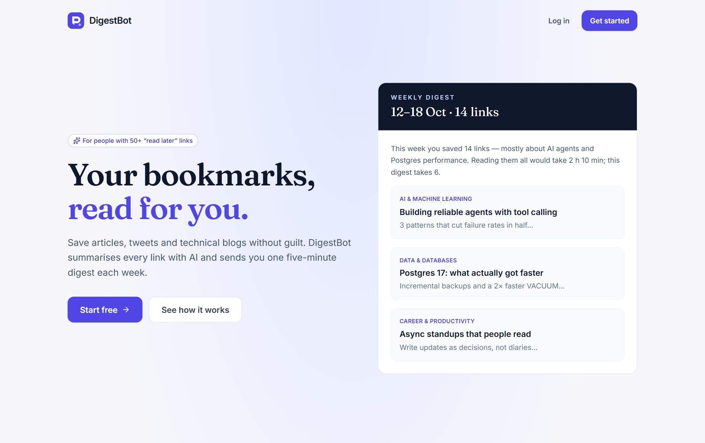 |
| Log in | 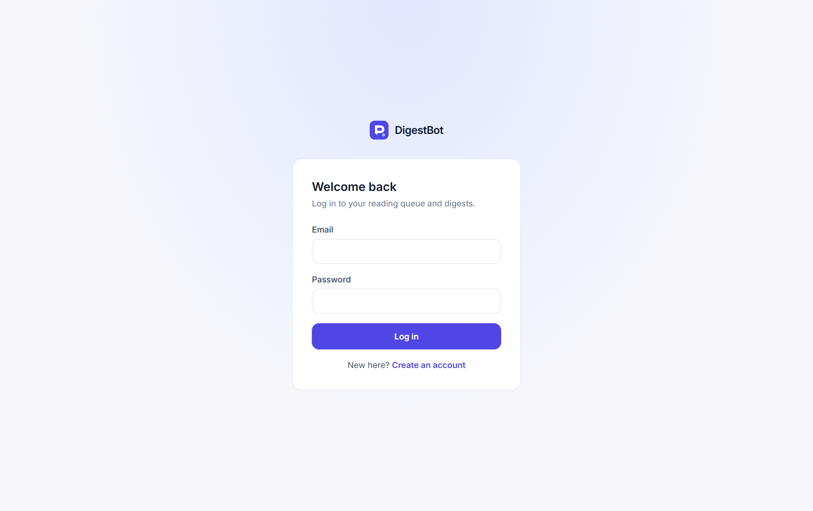 |
| Library (reading queue) | 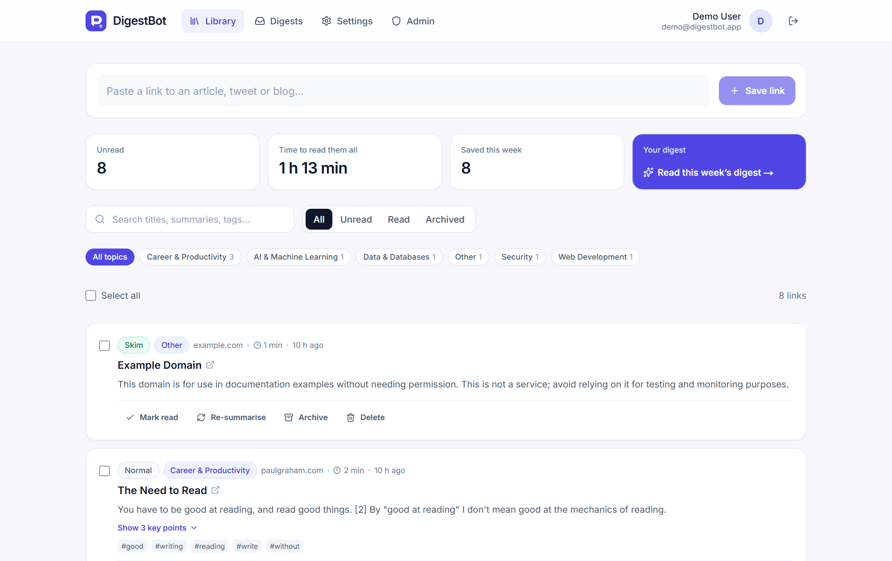 |
| Weekly digest | 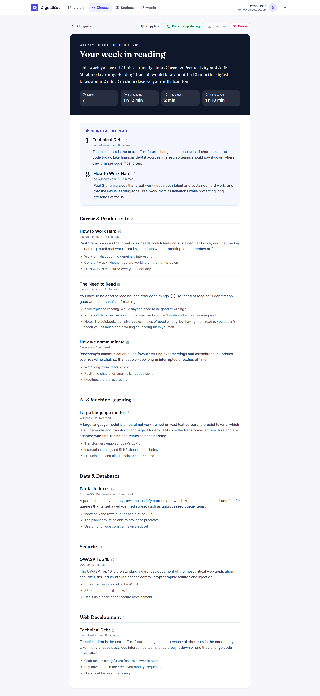 |
| Digest list | 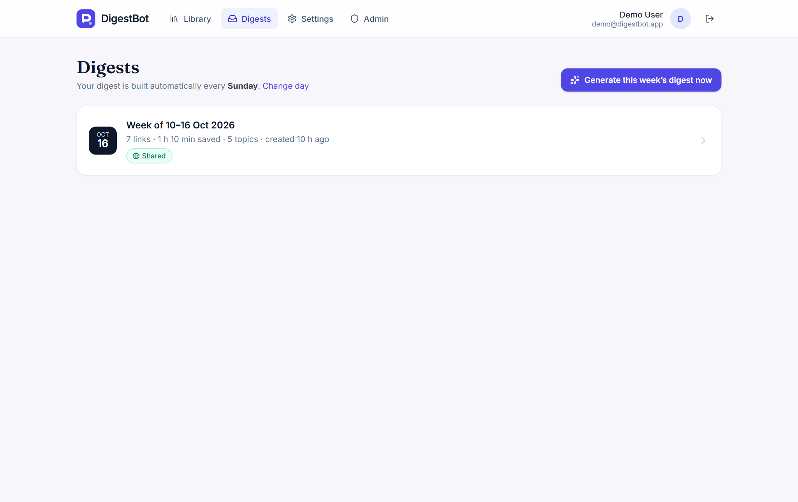 |
| Settings | 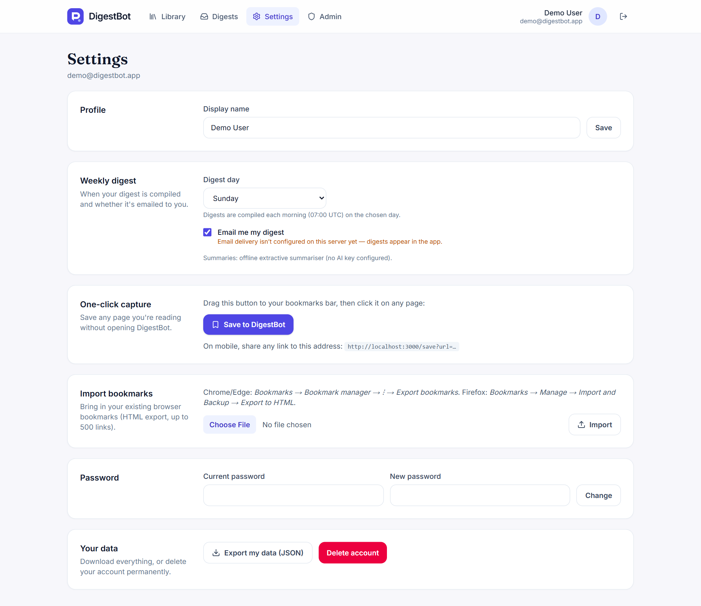 |
| Admin overview | 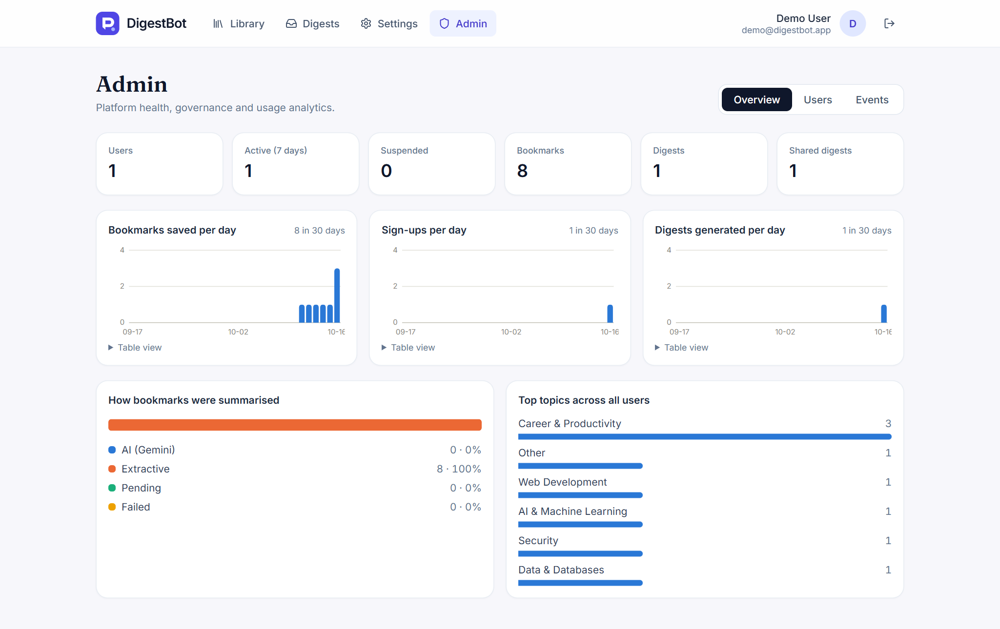 |
| Admin users | 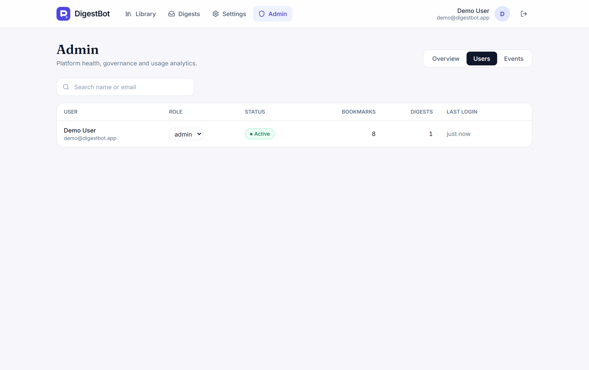 |
| Public shared digest | 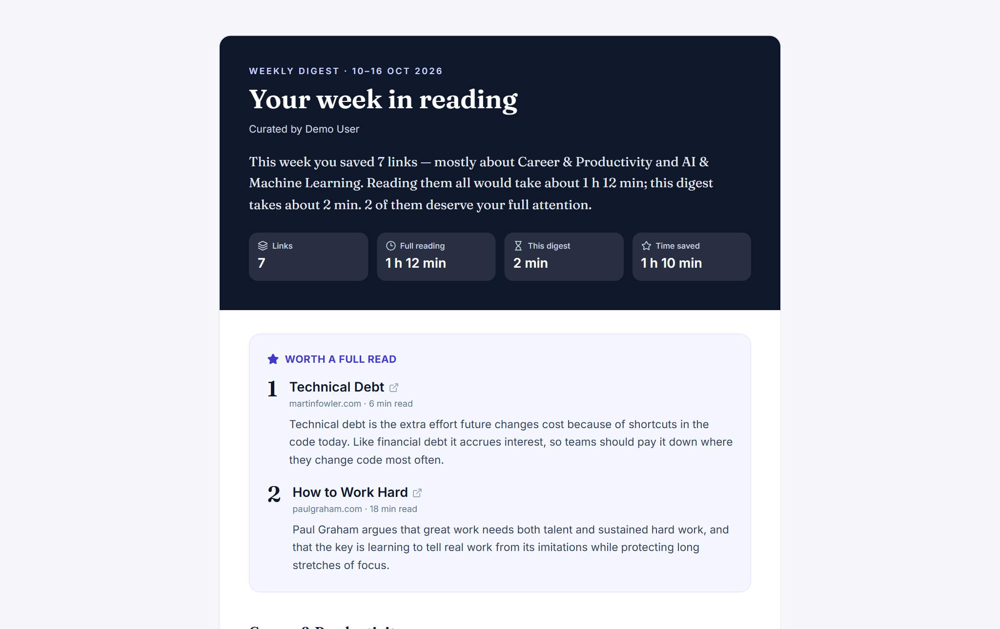 |
| Mobile library | 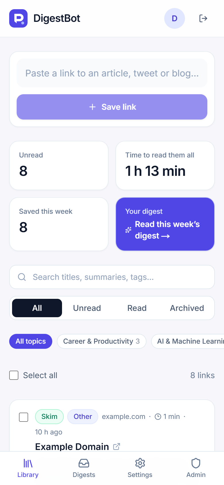 |
| Mobile digest | 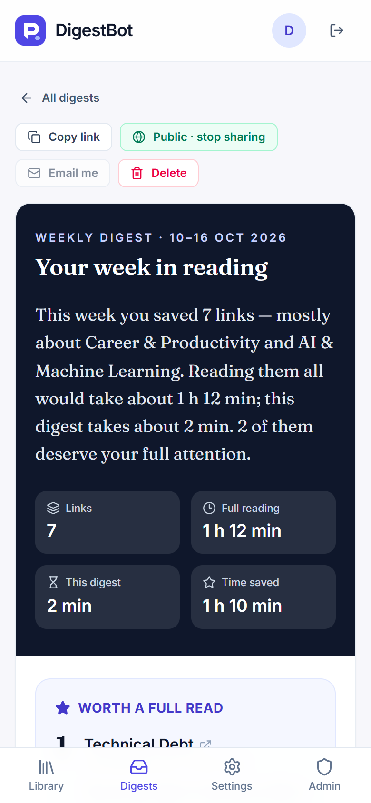 |

## Appendix B — User manual

1. **Sign up** at the live URL with your name, email and a password (8+ characters with a letter and a number).
2. **Save links:** paste a link into the box at the top of *Library* and press *Save link*. Within a few seconds the
   card shows a summary, key points, topic and reading time.
3. **One-click saving:** in *Settings → One-click capture*, drag *Save to DigestBot* to your bookmarks bar; click it
   on any page. On mobile, open `<site>/save?url=<link>`.
4. **Import old bookmarks:** export them from your browser as HTML, then *Settings → Import bookmarks*.
5. **Triage:** search, filter by status or topic, select several cards and mark read / archive / delete.
6. **Digest:** choose your digest day in *Settings*; it is built automatically each week. Or open *Digests →
   Generate this week's digest now*.
7. **Share:** on a digest, *Share publicly* copies a link anyone can open; *Public · stop sharing* revokes it.
8. **Your data:** *Settings → Export my data* downloads everything as JSON; *Delete account* removes it all.
9. **Admins** (emails listed in `ADMIN_EMAILS`): the *Admin* tab shows analytics, users (suspend, change role) and
   the event log.

## Appendix C — Installation and deployment guide

**Local:** install Node.js 20+, then
```
npm install
npm run db:seed        # demo@digestbot.app / digest-demo-1 (local only)
npm run dev            # http://localhost:3000
```
No database server is needed locally (embedded PGlite in `.data/`).

**Production (Vercel + Neon):**
1. `vercel login`, `vercel link` (creates the project).
2. Vercel → project → Storage → Create Database → Neon (Free) → connect to the project (sets `DATABASE_URL`).
3. Add `AUTH_SECRET` (≥ 32 random chars), `CRON_SECRET`, `ADMIN_EMAILS`; optionally `GEMINI_API_KEY`,
   `RESEND_API_KEY`, `EMAIL_FROM`, `APP_URL`.
4. `vercel deploy --prod` (or connect the GitHub repo for automatic deploys).
5. Check `/api/health`.

## Appendix D — API summary
23 endpoints under `/api`: `auth/{signup,login,logout,me}`, `bookmarks` (list, create), `bookmarks/{id}` (get,
update, delete), `bookmarks/{id}/resummarize`, `bookmarks/{batch,import,process}`, `digests` (list, create),
`digests/{id}` (get, share, delete), `digests/{id}/email`, `settings`, `settings/password`, `account`,
`account/export`, `admin/{metrics,users,events}`, `admin/users/{id}`, `cron/weekly`, `health`. Full contracts:
`docs/04-database-api-wireframes.md` §2.
