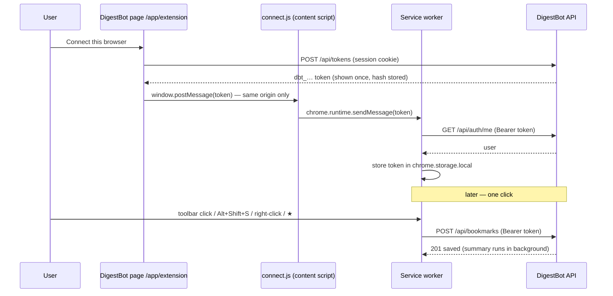

# Browser extension — one-click capture

**DigestBot** · Project ID PTUT-PRJ-096 · Extension v1.0.0 (Manifest V3; Chrome, Edge, Brave, Opera)

---

## 1. Why an extension

The bookmarklet and paste box work, but the Week 1 personas save links *while reading*, and the fastest possible
capture is one click on the page itself. An extension also solves the question “how does DigestBot get my
bookmarks?”: a website cannot read the browser’s bookmarks (the browser keeps them private), but an extension with
the `bookmarks` permission can.

| Way to save | How |
|---|---|
| **Toolbar button** | Click the DigestBot icon: the page is saved at once and the popup shows topic, reading time and summary when ready |
| **Keyboard** | `Alt` + `Shift` + `S` (changeable at `chrome://extensions/shortcuts`) |
| **Right-click** | “Save page to DigestBot” on a page, “Save link to DigestBot” on any link (without opening it) |
| **Browser ★** | Pages bookmarked with the browser’s own star are sent to DigestBot automatically (option, on by default; bulk imports from another browser are ignored) |
| **Import all** | One button in the extension settings sends every existing browser bookmark (in chunks of 500) |

## 2. Install (users)

1. In DigestBot open **Settings → Browser extension** (or `/app/extension`) and download the `.zip`; unzip it.
2. Open `chrome://extensions` (Edge: `edge://extensions`, Opera: `opera://extensions`), turn on **Developer mode**,
   click **Load unpacked** and choose the unzipped folder — the one with `manifest.json` directly inside it.
   *“Manifest file is missing or unreadable”* means the chosen folder is one level too high (some unzip tools
   create `digestbot-extension\digestbot-extension\`): choose the inner folder. Since 17 Oct the zip keeps
   `manifest.json` at its root, so Windows “Extract All” and 7-Zip/WinRAR “Extract to …\” give the right folder.
3. The extension opens DigestBot’s *Browser extension* page by itself; click **Connect this browser**. Done —
   pin the icon from the puzzle-piece menu.

Publishing to the Chrome Web Store (one-time US$5 developer fee and a review) or Microsoft Edge Add-ons (free)
would remove the Developer-mode step; the extension is ready for that as-is.

## 3. Design

**Files** (`extension/`): `manifest.json`, `background.js` (service worker: menus, ★ listener, badge, receives the
token), `popup.html/js` (the one click), `options.html/js` (connection, server, ★ toggle, import all),
`connect.js` (content script that runs only on DigestBot’s own `/app/extension` page), `lib.js` (shared logic,
unit-tested), `ui.css`, `icons/`. No build step; `scripts/pack-extension.mjs` zips it into
`public/digestbot-extension.zip` before every build, so the live site always serves the current version.

**Server additions**
| Endpoint | Auth | Purpose |
|---|---|---|
| `GET /api/tokens` | session | List connected browsers |
| `POST /api/tokens` | session | Create a token (max 10 per user, rate-limited) |
| `DELETE /api/tokens/{id}` | session | Disconnect a browser from the website |
| `POST /api/extension/disconnect` | token | The extension revokes its own token |
| `POST /api/bookmarks/import-links` | session or token | Import a JSON list (≤ 500) of links |
| `POST /api/bookmarks`, `GET /api/bookmarks/{id}`, `GET /api/auth/me` | session or token | Save, read back for the popup’s summary, show who is connected |

Table `api_tokens` (migration `drizzle/0001_api_tokens.sql`): `id`, `user_id` (cascade), `name`, `token_hash`
(unique), `prefix`, `created_at`, `last_used_at`.

## 4. Security

| Concern | Decision |
|---|---|
| Password exposure | The extension never sees the password; it holds a random 256-bit token (`dbt_` + 43 chars) |
| Token theft from the database | Only the SHA-256 hash is stored; the plaintext is shown once |
| Least privilege | A request with `Authorization: Bearer` is authenticated **only** by the token and **only** on routes that opt in (`requireUser({ allowToken: true })`): save, read one bookmark, who-am-I, import. Digests, settings, account deletion and admin answer 401 (verified in Chrome) |
| CSRF | Bearer requests never use the cookie, so the Origin check is skipped for them alone; cookie requests keep it |
| Token hand-over | `connect.js` is injected only on DigestBot’s own origin; it accepts only same-window, same-origin messages; the service worker re-checks the token with `/api/auth/me` before storing it |
| Revocation | Disconnect in the extension (deletes its own token) or on the website; reconnecting revokes the previous token; suspended users’ tokens stop working immediately |
| Browser permissions | `activeTab` (the current tab only when you click — no “read all your browsing history” warning), `contextMenus`, `storage`, `bookmarks`; network access only to DigestBot (other servers need an explicit permission prompt) |
| Untrusted pages | The extension sends only the URL and title; the server fetches the page itself through the SSRF-safe fetcher |

## 5. Testing

- **Unit:** `tests/extension.test.ts` — server-address validation (https only, http only for localhost), which URLs
  can be saved (not `chrome://`, `file://`, extension pages), bookmark-tree flattening and de-duplication,
  chunking (17 tests).
- **Integration:** `tests/services.test.ts` “extension tokens” — hash-only storage, opt-in routes, no cookie
  fallback, last-used tracking, JSON import, suspension, revocation, 10-browser limit (7 tests).
- **End-to-end in real Chrome 155** (`scripts/digestbot-ext-e2e.mjs` in the parent folder; fresh profile, local
  server): 16/16 checks — installs, service worker starts, website detects the extension, connect flow, token
  stored, reconnect replaces the old token, **popup saves the page in one click and shows the summary**, duplicate
  detection, **★ bookmark saved automatically**, import all, token refused by the digests API, options page state,
  disconnect revokes the token. *Note:* a scripted `chrome.action.openPopup()` does not grant `activeTab` the way a
  real click does, so the test installs a copy with the `tabs` permission added; the shipped manifest is unchanged.
- Defect found by the E2E run and fixed: the offline summariser could repeat a sentence and keep footnote numbers
  (“2: The pyramid…”); sentences are now de-duplicated and list/footnote markers stripped (regression test added).

Screenshots: `screenshots/12-extension-connected.png`, `13-extension-popup.png`, `14-extension-options.png`.
